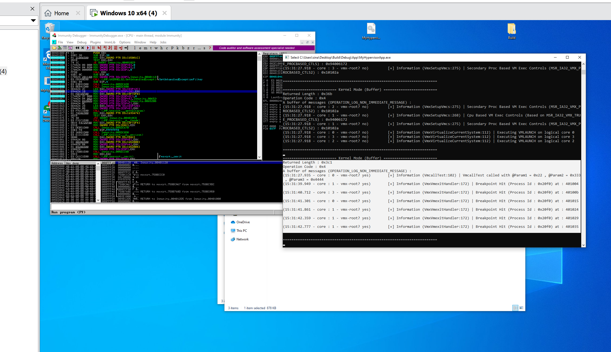
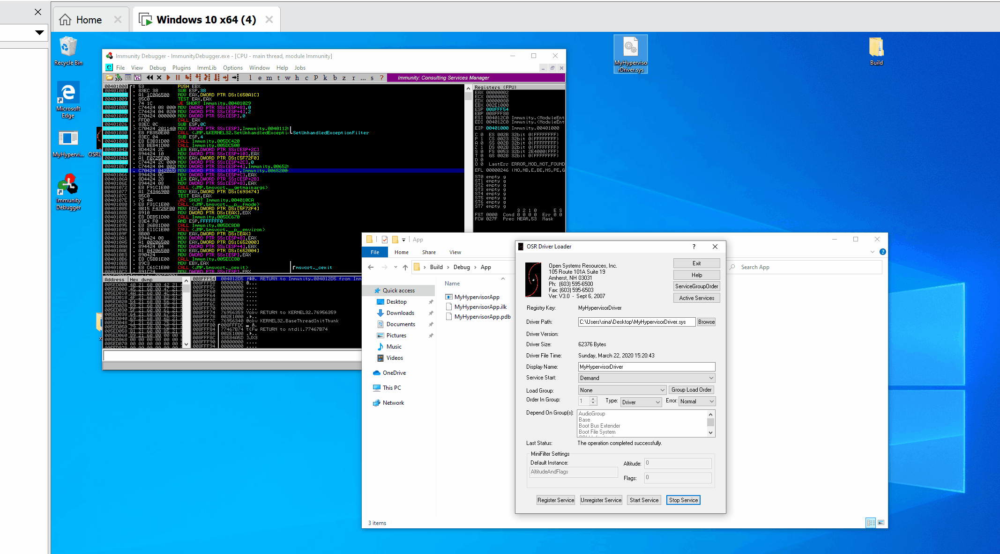
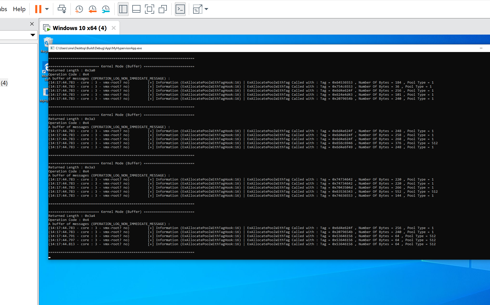
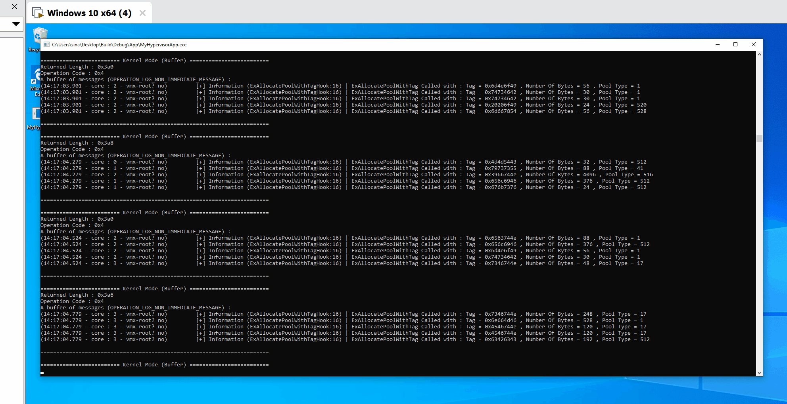
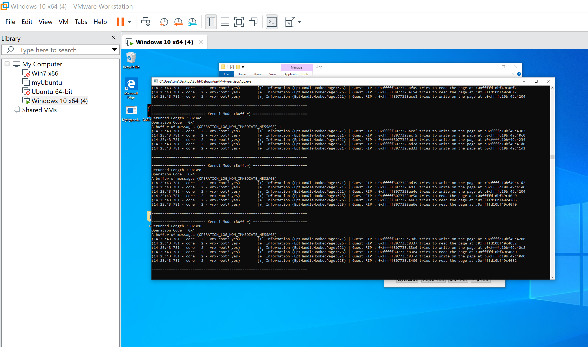
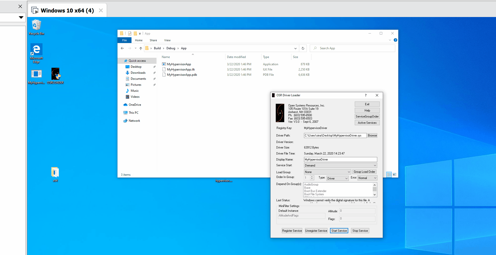
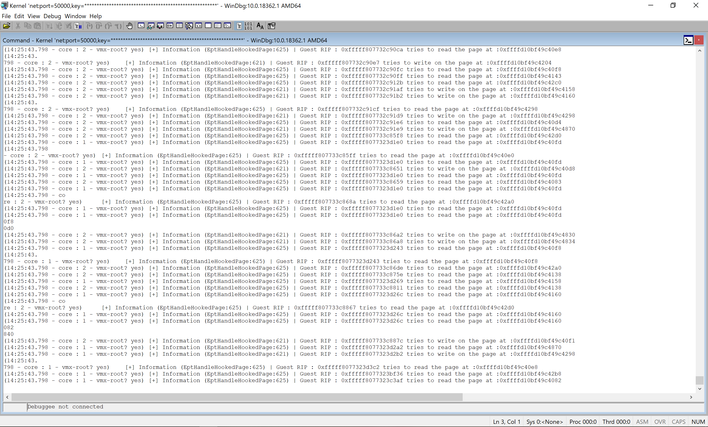
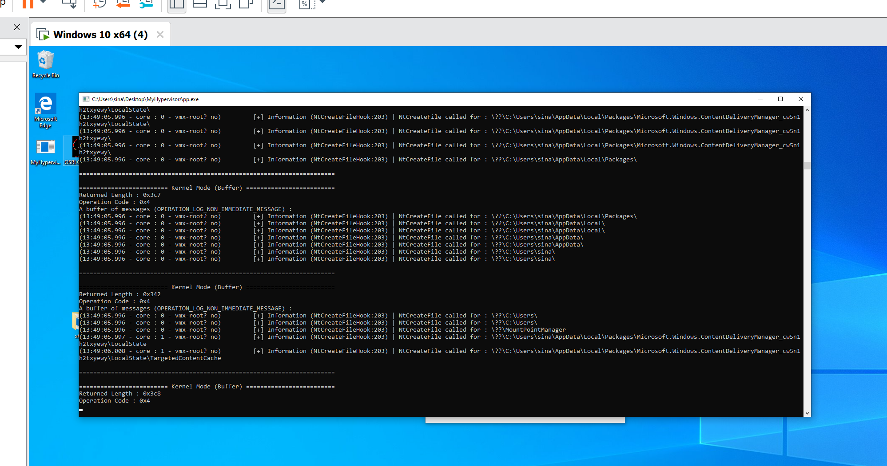
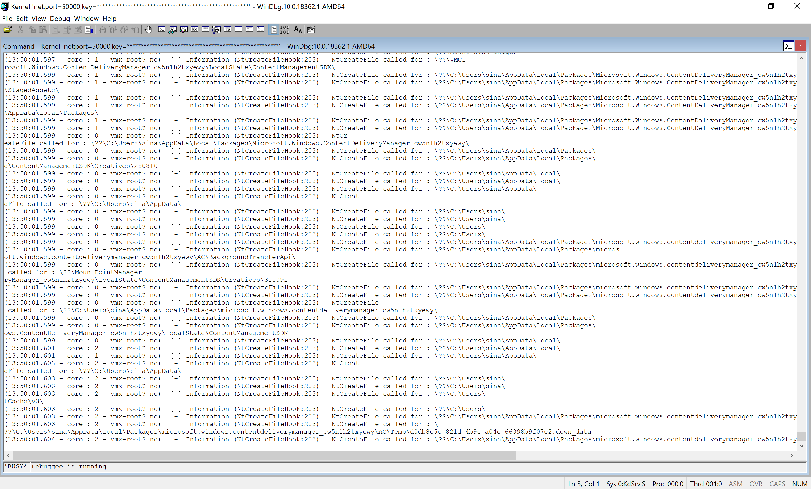
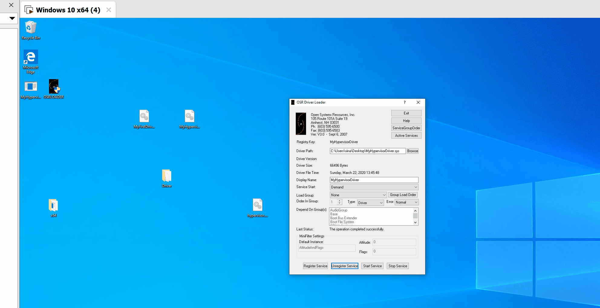

# VT-x Hypervisor Monitor

A lightweight Intel VT-x based hypervisor for Windows x64 that virtualizes guest execution using VMX root and VMX non-root modes. The project demonstrates low-level CPU control, VMCS configuration, VM-exit handling, Extended Page Tables, EPT hooks, syscall monitoring, and kernel-to-user event reporting through a Windows driver and companion user-mode controller.

## Project Statement

To engineer a hardware-assisted hypervisor that can virtualize a live Windows execution environment, intercept low-level processor events, monitor memory access through EPT, and expose useful telemetry to a user-mode application for debugging, research, and systems analysis.

## Background

Modern security research and kernel development often require visibility below the operating system. Intel VT-x provides that lower layer by allowing a hypervisor to run in VMX root mode while the operating system continues in VMX non-root mode. When configured events occur, the processor transfers control to the hypervisor through VM-exits.

This project builds that flow directly in a Windows kernel driver. It shows how VMX operation is enabled, how VMCS state is prepared, how a running system can be virtualized, and how EPT can be used to observe or redirect guest memory behavior without relying on ordinary OS-level hooks alone.

## Features

- Intel VT-x based virtualization
- VMX root and VMX non-root execution
- VMXON and VMCS region management
- Guest-state and host-state VMCS setup
- VM-entry and VM-exit control configuration
- Guest launch and resume using `VMLAUNCH` and `VMRESUME`
- Assembly-backed VM-exit dispatch path
- Extended Page Table address translation
- EPT violation and misconfiguration handling
- Page-level read, write, and execute monitoring
- EPT-based hidden hook demonstrations
- Syscall hook demonstration using `NtCreateFile`
- Event injection for selected processor exceptions
- Exception bitmap interception examples
- VMCALL command interface
- INVEPT based EPT translation invalidation
- VPID support in the advanced implementation
- MSR and control-register virtualization logic
- Per-core VMX initialization and teardown
- User-mode controller for driver interaction
- IOCTL based kernel-to-user log delivery

## Architecture

The project is built around two main executables: a kernel-mode hypervisor driver and a user-mode controller application.

```text
User Mode Controller
        |
        | CreateFile / DeviceIoControl / CloseHandle
        v
Windows Kernel Driver
        |
        | DriverEntry / IRP dispatch / IOCTL handling
        v
Hypervisor Core
        |
        | VMXON / VMCS setup / EPT setup
        v
VMX Root Mode
        |
        | VM-exit handler / VMCALL / EPT violation handling
        v
Guest Windows Execution
        |
        | Runs in VMX non-root mode
        v
Monitored System Activity
```

The user-mode application validates CPU support, opens the device exposed by the driver, receives hypervisor logs, and coordinates shutdown. The kernel driver initializes VMX on logical processors, configures VMCS fields, prepares EPT structures, handles VM-exits, and performs low-level monitoring tasks.

## Methodology

- **VMX Transitions:** The driver enables VMX operation, prepares VMXON regions, loads VMCS state, launches guest execution, and resumes the guest after VM-exits.
- **VMCS Initialization:** Guest state, host state, control fields, MSR behavior, segment state, execution controls, entry controls, and exit controls are prepared so the processor can safely transition between guest and hypervisor contexts.
- **VM-Exit Handling:** Assembly stubs preserve guest state and transfer control to C handlers that inspect the exit reason, decode exit qualification, process the event, and resume guest execution.
- **Extended Page Tables:** EPT structures translate guest physical memory to host physical memory and allow the hypervisor to control read, write, and execute permissions independently from guest page tables.
- **EPT Hooks:** Selected pages can be monitored or redirected by changing EPT permissions, handling EPT violations, restoring page state, and invalidating stale EPT translations.
- **Event Injection:** The hypervisor can inject selected exceptions back into the guest, including breakpoint, general protection, and undefined opcode events.
- **User-Mode Telemetry:** Kernel logs are buffered and sent to the controller through IOCTLs, making VMX, EPT, hook, and syscall activity visible from user mode.

## Core Components

### User-Mode Controller

Responsible for:

- checking CPU vendor and VT-x support,
- opening `\\.\MyHypervisorDevice`,
- receiving log buffers from the driver,
- displaying VMX and EPT activity,
- triggering hypervisor shutdown through device cleanup.

### Kernel Driver

Responsible for:

- creating the device object and symbolic link,
- handling IRP create, close, read, write, and device-control requests,
- starting VMX initialization,
- exposing IOCTL communication,
- cleaning up VMX state during unload or device close.

### VMX Core

Responsible for:

- validating VMX support,
- setting required `CR0` and `CR4` bits,
- allocating VMXON and VMCS regions,
- allocating per-core VMM stacks,
- configuring VMCS fields,
- launching and resuming guest execution.

### VM-Exit Dispatcher

Responsible for:

- saving guest register state,
- reading VM-exit reason and qualification,
- handling exceptions, VMCALLs, EPT exits, and selected CPU events,
- advancing guest RIP when required,
- restoring context and resuming the guest.

### EPT Engine

Responsible for:

- creating EPT paging structures,
- mapping guest memory,
- handling EPT violations,
- splitting large mappings into page-granular entries,
- changing page permissions,
- invalidating EPT translations,
- tracking hooked pages.

### Hooking And Monitoring Layer

Responsible for:

- syscall hook demonstrations,
- hidden hook demonstrations,
- read/write/execute monitoring,
- hook trampoline logic,
- restoring page visibility after monitored access.

### Logging Layer

Responsible for:

- collecting kernel events,
- buffering messages,
- assigning operation codes,
- delivering messages through IOCTLs,
- optionally mirroring output to debugger logs.

## Execution Flow

```text
Start controller application
        |
        v
Controller opens hypervisor device
        |
        v
Driver initializes VMX on logical processors
        |
        v
Driver configures VMCS and EPT
        |
        v
Windows execution enters VMX non-root mode
        |
        v
Configured event triggers VM-exit
        |
        v
Hypervisor handles event in VMX root mode
        |
        v
Telemetry is logged to user mode
        |
        v
Guest resumes with VMRESUME
```

## VMCS Specification

The VMCS is configured across the major Intel VT-x field groups:

- **Guest state:** guest RIP, RSP, RFLAGS, control registers, segment registers, descriptor tables, and activity state.
- **Host state:** host RIP, RSP, control registers, segment selectors, descriptor tables, and MSR-related host state.
- **Execution controls:** CPU-based controls, secondary processor controls, exception bitmap, CR masks, MSR bitmap behavior, and EPT enablement.
- **Entry controls:** guest entry behavior and event injection state.
- **Exit controls:** host transition behavior, state saving, state loading, and exit reporting.

Correct VMCS setup is critical because invalid guest state or invalid control combinations can cause VM-entry failure before the guest ever runs.

## EPT Specification

EPT provides second-level address translation:

```text
Guest Virtual Address
        |
        | guest page tables
        v
Guest Physical Address
        |
        | EPT
        v
Host Physical Address
```

The EPT implementation supports:

- PML4, PDPT, PD, and PT style hierarchy,
- 2 MB mappings for broad coverage,
- 4 KB splits for page-level monitoring,
- read/write/execute permission bits,
- memory type handling,
- EPT violation dispatch,
- EPT misconfiguration detection,
- INVEPT invalidation after permission changes.

## EPT Monitoring Workflow

```text
Target page selected
        |
        v
EPT permissions changed
        |
        v
Guest attempts read/write/execute
        |
        v
CPU raises EPT violation
        |
        v
Hypervisor logs or redirects access
        |
        v
EPT state is restored or updated
        |
        v
Guest execution resumes
```

This is the mechanism used for page-level monitoring and hidden hook demonstrations.

## VMCALL Interface

The hypervisor exposes a small command interface through VMCALL.

Supported commands include:

- `VMCALL_TEST`
- `VMCALL_VMXOFF`
- `VMCALL_CHANGE_PAGE_ATTRIB`
- `VMCALL_INVEPT_ALL_CONTEXTS`
- `VMCALL_INVEPT_SINGLE_CONTEXT`
- `VMCALL_UNHOOK_ALL_PAGES`
- `VMCALL_UNHOOK_SINGLE_PAGE`

These commands allow controlled requests for hypervisor actions such as testing VMCALL dispatch, shutting down VMX operation, changing EPT attributes, invalidating EPT translations, and removing installed hooks.

## Examples

The repository includes visual demonstrations of the hypervisor monitor in action.

### Event Injection And Exception Bitmap

Demonstrates breakpoint and exception interception while the user-mode controller displays VM-exit and event logs.





### Hidden Hook Execute

Demonstrates execute-path interception using EPT-controlled page visibility.





### Hidden Hook Read / Write

Demonstrates page-level read and write monitoring through EPT violations and hooked-page handling.







### Syscall Hook

Demonstrates `NtCreateFile` monitoring and file path logging through the hook path.







## Tools And Technologies

| Category | Technology |
| --- | --- |
| Language | C, C++, x64 Assembly |
| Platform | Windows x64 |
| Virtualization | Intel VT-x, VMX |
| Memory Virtualization | Extended Page Tables |
| Driver Model | Windows Kernel Driver |
| Communication | Device object, symbolic link, IOCTL |
| Debugging | WinDbg, DbgPrint, user-mode log forwarding |
| Build Tools | Visual Studio, Windows SDK, Windows Driver Kit |

## Getting Started

Prerequisites:

- Windows x64
- Intel CPU with VT-x enabled in BIOS/UEFI
- Visual Studio
- Windows SDK
- Windows Driver Kit
- OSR Driver Loader
- WinDbg or DebugView for debugging output
- VMware nested virtualization or a dedicated test machine

## Building

Open the Visual Studio solution for the hypervisor monitor build and compile both projects:

- `MyHypervisorDriver.sys`
- `MyHypervisorApp.exe`

Recommended build flow:

1. Open the hypervisor solution in Visual Studio.
2. Select the x64 build configuration.
3. Build the kernel driver project.
4. Build the user-mode controller project.
5. Copy the generated driver and application binaries to the test machine or test VM.

## Running

Enable test signing if required:

```bat
bcdedit /set testsigning on
```

Reboot after enabling test signing.

Load the driver using **OSR Driver Loader**:

1. Open OSR Driver Loader as Administrator.
2. Browse to `MyHypervisorDriver.sys`.
3. Register the driver service.
4. Start the driver.
5. Run `MyHypervisorApp.exe`.
6. Observe VMX, VM-exit, EPT, hook, and syscall logs in the console or debugger.

## Testing

Basic validation:

- CPU vendor is detected as `GenuineIntel`.
- VMX support is detected.
- Driver loads successfully in OSR Driver Loader.
- User-mode app opens `\\.\MyHypervisorDevice`.
- VMX initialization logs are visible.
- Guest execution continues after virtualization.
- VM-exit and EPT activity appears during monitored operations.
- Closing the controller terminates VMX operation cleanly.

## Notes

- Use a VM snapshot before loading the driver.
- Prefer VMware nested virtualization or a dedicated lab machine.
- Keep WinDbg or DebugView open while testing.
- Avoid running experimental hypervisor builds on a production system.


## Benchmarking

`MyHypervisorApp` includes a built-in microbenchmark harness (`RunHypervisorBenchmarks`) that measures:

- **`CPUID` VM-exit round-trip latency** in CPU cycles using `__rdtscp` over 10,000 iterations (median and p99).
- **`CreateFileW` (`NtCreateFile`) syscall latency** in microseconds using `QueryPerformanceCounter` over 1,000 iterations to quantify EPT hook overhead.

| Metric | Baseline (No Hypervisor) | With Hypervisor + EPT Hook |
| :--- | :---: | :---: |
| `CPUID` round-trip (median / p99) | *Pending VM run* | *Pending VM run* |
| `CreateFileW` (`NtCreateFile`) median / p99 | *Pending VM run* | *Pending VM run* |

## References

- [VT-x Hypervisor Monitor](https://github.com/Prabhav-P2006/VT-x-Hypervisor-Monitor)
- [HyperDbg](https://github.com/HyperDbg/HyperDbg)
- [Awesome Virtualization](https://github.com/Wenzel/awesome-virtualization)
- [Intel 64 and IA-32 Architectures Software Developer's Manual](https://www.intel.com/content/www/us/en/developer/articles/technical/intel-sdm.html)
